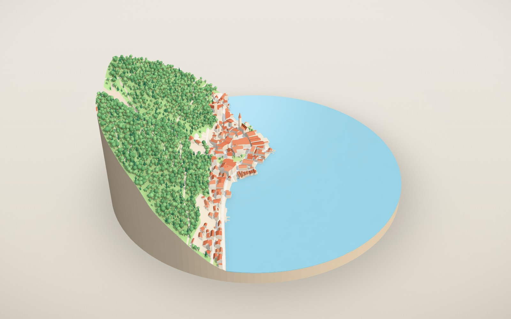
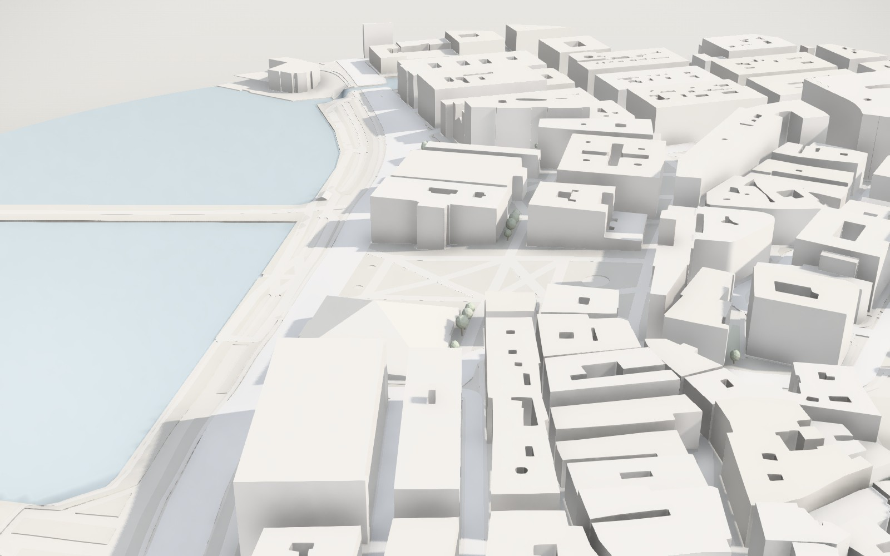
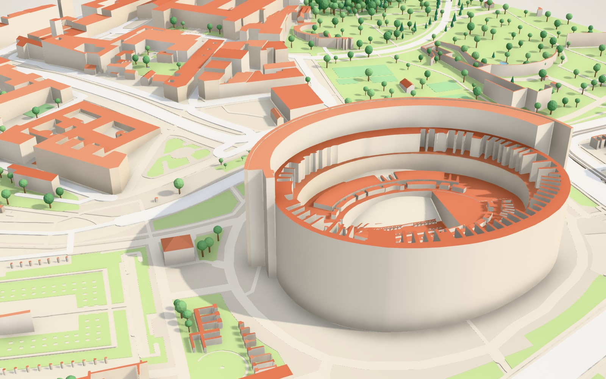

# pop3d

**Il mondo in miniatura.** Scrivi un indirizzo, un CAP, il nome di un luogo o delle coordinate e
pop3d ricostruisce quel pezzo di mondo come un piccolo plastico 3D: edifici, strade, acqua, verde,
alberi e rilievi veri, presi da OpenStreetMap e dai modelli altimetrici, resi con uno stile da
diorama. Poi lo esplori, lo personalizzi e lo esporti, anche per la stampa 3D.



| | |
|---|---|
|  |  |

> *In short:* type any place on Earth and get a stylised, explorable 3D diorama built from real
> OpenStreetMap and elevation data. Restyle it, isolate its layers, export it as GLB/OBJ, or as
> watertight STL/3MF for 3D printing. Bun on the server, three.js in the browser, no API keys.

## Cosa fa

- **Qualsiasi luogo**: ricerca con suggerimenti, indirizzi, CAP, coordinate in ogni formato
  (decimali, gradi-minuti-secondi, link di Google Maps e OpenStreetMap), posizione corrente.
- **Area libera**: cerchio, rettangolo, rettangolo smussato o esagono, da 120 m a 5 km, anche con
  proporzioni libere; il centro si sposta trascinando una mappa sotto il mirino.
- **Dati reali**: edifici con altezze e volumi 3D, tetti a falde e cupole, strade, sentieri,
  ferrovie, fiumi, laghi e mare (ricostruito dalle linee di costa), parchi, boschi, coltivi,
  roccia e ghiacciai, alberi mappati e boschi riempiti in modo procedurale, rilievo dal modello
  altimetrico con esagerazione regolabile.
- **Stile**: otto atmosfere curate (Diorama, Plastico, Mediterraneo, Carta, Menta, Grafite,
  Notte, Blueprint), ogni colore modificabile, edifici colorati per tema, altezza o funzione,
  contorni a filo, superfici sfaccettate low-poly, tre livelli di dettaglio.
- **Luce**: sole orientabile con una meridiana, ombre morbide, occlusione ambientale, effetto
  miniatura tilt-shift, rotazione automatica.
- **Livelli**: ogni elemento si nasconde, si isola o si evidenzia; i singoli edifici si
  selezionano per leggerne i dati e si possono nascondere uno a uno.
- **Esportazione**: PNG fino a 4× (anche con sfondo trasparente), GLB e OBJ a colori in metri,
  STL e 3MF multicolore per la stampa: solidi chiusi, in millimetri, con base, scala ed
  esagerazione verticale a scelta.
- **Condivisione**: l'indirizzo della pagina riproduce esattamente il diorama che stai guardando.

Scorciatoie: `/` cerca · `1`–`5` pannelli · `R` vista iniziale · `T` dall'alto · `N` nord in alto ·
`Spazio` rotazione · `H` nasconde l'interfaccia · `Esc` chiude.

## Come è fatto

```
browser                                   server (Bun)
┌──────────────────────────────┐          ┌───────────────────────────────┐
│ interfaccia (TypeScript)     │  /api/*  │ geocoding  → Photon, Nominatim│
│ viewer three.js              │ ───────► │ OSM        → mirror Overpass  │
│ web worker: geometria        │          │ altimetria → tile Terrarium   │
└──────────────────────────────┘          │ cache su disco, limiti d'uso  │
                                          └───────────────────────────────┘
```

- **`server/`** – un solo processo `Bun.serve`: serve l'app e fa da tramite verso i servizi
  aperti. Le richieste a Overpass partono scaglionate su più mirror (vince il primo che risponde),
  gli estratti vengono ridotti a un formato compatto e messi in cache su disco; un estratto
  scaduto viene servito subito mentre si aggiorna in secondo piano.
- **`src/worker/`** – tutta la geometria nasce in un web worker. I poligoni passano da
  [Clipper2](https://github.com/countertype/clipper2-ts) (unioni, ritagli sul bordo, strade come
  nastri) e vengono poi **tassellati lungo la griglia del terreno**: ogni livello si piega sui
  rilievi negli stessi punti, quindi strade e prati restano paralleli al suolo senza mai
  attraversarlo. La stessa tassellazione produce i solidi chiusi per la stampa.
- **`src/scene/`** – resa con three.js: una mesh per livello, colori per vertice sugli edifici,
  alberi istanziati, animazione di crescita in shader, ombre aggiornate solo quando serve,
  disegno solo quando qualcosa cambia e risoluzione adattiva durante il movimento.
- **`src/ui/`** – interfaccia senza framework: pochi componenti, uno stato osservabile, italiano
  e inglese.

## Sviluppo

Serve [Bun](https://bun.sh) ≥ 1.3.

```bash
bun install
```

```bash
bun run dev
```

Apre il server su <http://localhost:3000> con ricostruzione e ricarica automatica.

```bash
bun test
```

```bash
bun run typecheck
```

```bash
bun run scripts/probe.ts "45.6503,13.7678" 800 circle 1 1.4
```

L'ultimo comando costruisce un diorama senza browser, contro un server in esecuzione, e stampa
quanti triangoli escono per livello.

## Produzione

```bash
bun install --production
```

```bash
bun run build
```

```bash
bun run start
```

Il server ascolta su `PORT` (3000) e comprime da solo le risposte; dietro un reverse proxy basta
inoltrare tutto. In `deploy/pop3d.service` c'è un'unità systemd pronta.

| Variabile | Predefinito | A cosa serve |
|---|---|---|
| `PORT`, `HOST` | `3000`, `0.0.0.0` | Dove ascoltare |
| `POP3D_CACHE_DIR` | `./.cache` | Cache su disco di estratti OSM, tile altimetriche, geocoding |
| `POP3D_CACHE_MAX_MB` | `2048` | Spazio massimo della cache (le voci più vecchie vengono eliminate) |
| `POP3D_USER_AGENT` | `pop3d/<versione>` | Come presentarsi ai servizi a monte: aggiungi un contatto, come chiedono le loro regole d'uso |
| `POP3D_OVERPASS` | quattro mirror pubblici | Elenco di endpoint Overpass, separati da virgola |
| `POP3D_NOMINATIM`, `POP3D_PHOTON` | istanze pubbliche | Servizi di geocoding |
| `POP3D_DEM_TILES` | tile Terrarium su AWS | Modello `{z}/{x}/{y}` delle tile altimetriche |
| `POP3D_MAX_SPAN` | `6500` | Lato massimo, in metri, di un'area richiesta |

## Dati e licenze

- Mappa © [OpenStreetMap](https://www.openstreetmap.org/copyright) contributors, licenza ODbL,
  interrogata tramite [Overpass API](https://overpass-api.de); ricerca tramite
  [Photon](https://photon.komoot.io) e [Nominatim](https://nominatim.org).
- Altimetria: [Terrain Tiles](https://registry.opendata.aws/terrain-tiles/) di Mapzen su AWS
  Open Data ([attribuzioni](https://github.com/tilezen/joerd/blob/master/docs/attribution.md)).
- I servizi pubblici usati hanno regole d'uso: per un traffico serio conviene puntare le
  variabili qui sopra a istanze proprie.
- Codice sotto licenza [MIT](LICENSE).
